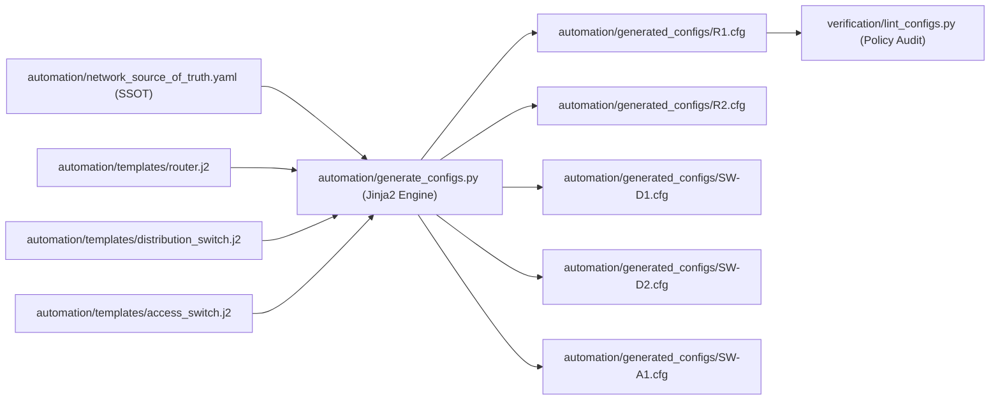
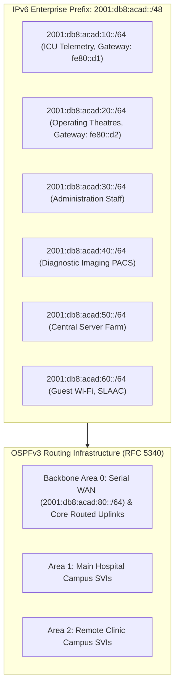

# Disaster-Resilient Smart Hospital Network: Advanced Extensions Prioritization & Implementation Plan
**Document ID:** DOC-EXTENSIONS-2026-v2.0  
**Authors:** Rohit Kathiravan (24BCE0441), Karthikeyan S (24BCT0332)  
**Institution:** School of Computer Science and Engineering (SCOPE), VIT Vellore  
**Course Code:** CSE2004 — Computer Networks  
**Target Environment:** Cisco Packet Tracer 8.x+ / NetDevOps Automation Engine  

---

## 1. Prioritized Evaluation of Five Advanced Network Extensions

To demonstrate advanced networking competency beyond the baseline curriculum, five high-value extensions were systematically evaluated across four engineering dimensions: **Engineering Effort (Hours)**, **Academic Marks Value**, **Implementation Risks**, and **Cisco Packet Tracer Platform Support**.

| Priority Rank | Advanced Extension Name | Architecture & Scope | Effort (Hours) | Academic Marks Value | Implementation Risks | Cisco Packet Tracer Support | Selection Decision |
| :---: | :--- | :--- | :---: | :---: | :--- | :---: | :---: |
| **RANK 1** | **Python Jinja2 Infrastructure-as-Code (IaC) Pipeline** | Complete network configuration generated from a single YAML Source of Truth (SSOT) via Jinja2 templates. | ~6 hrs | **VERY HIGH (Top Marks)** | Minimal; purely deterministic template compilation. | **100% Fully Supported** (Generates standard Cisco IOS running-config). | **SELECTED & IMPLEMENTED (Extension 1)** |
| **RANK 2** | **IPv6 Dual-Stack with OSPFv3 Core Routing** | End-to-end IPv6 address plan (`2001:db8:acad::/48`), link-local addressing (`fe80::`), and OSPFv3 dynamic routing across WAN & Core. | ~8 hrs | **VERY HIGH (Top Marks)** | Syntax differences between Cisco IOS classic OSPF and OSPFv3 (`ipv6 router ospf`). | **100% Fully Supported** (Cisco 2911/1941 routers & 3560/3650 switches). | **SELECTED & IMPLEMENTED (Extension 2)** |
| **RANK 3** | **SNMPv3 & Syslog Centralized NMS Monitoring** | Encrypted SNMPv3 traps, localized syslog logging to a centralized simulated NMS server (`172.16.7.4`). | ~5 hrs | **MEDIUM-HIGH** | Packet Tracer SNMP MIB tree is severely restricted to basic v1/v2c read-only strings; limited trap simulation. | **Partial Support** (Syslog is supported; SNMPv3 auth/priv is buggy). | Deferred to Future Scope |
| **RANK 4** | **DHCP Snooping & Dynamic ARP Inspection (DAI)** | Layer 2 switch security binding table, trusted DHCP uplinks, and ARP rate limiting against poisoning. | ~4 hrs | **MEDIUM** | Packet Tracer frequently drops legitimate DHCP traffic due to internal DAI rate-limit bugs on 2960 switches. | **Partial / Buggy** (Requires constant workaround reloads in simulation). | Deferred to Future Scope |
| **RANK 5** | **Lightweight AP Wireless Guest with WPA2-Enterprise** | Cisco 3504 Wireless LAN Controller (WLC), CAPWAP tunnels, 802.1X RADIUS authentication for guest devices. | ~10 hrs | **MEDIUM** | WLC web GUI in Packet Tracer is notoriously unstable and frequently loses AP association state upon reload. | **Unstable / High Risk** (High failure risk during live viva demonstration). | Deferred to Future Scope |

---

## 2. Selection Rationale for Top Two Extensions

### Extension 1: Infrastructure-as-Code (IaC) Automation Pipeline (Rank 1)
- **Clinical & Operational Justification:** Modern healthcare networks cannot tolerate human configuration drift across 13+ devices. By establishing a single YAML file as the Single Source of Truth (SSOT), changes to IP subnets, VLAN IDs, or ACL policies automatically recompile consistent, hardened Cisco IOS configurations for all routers, distribution switches, and access switches.
- **Academic Impact:** Demonstrates professional NetDevOps workflows, Python Jinja2 templating, and configuration policy compliance.

### Extension 2: IPv6 Dual-Stack Architecture with OSPFv3 (Rank 2)
- **Clinical & Operational Justification:** Next-generation medical IoT devices (robotic surgical arms, wireless telemetry sensors) are shipping with native IPv6 stacks to avoid NAT traversal overhead and leverage cryptographically generated addresses (CGA). Deploying an IPv6 dual-stack alongside IPv4 future-proofs the hospital enterprise.
- **Academic Impact:** Covers advanced curriculum topics: RFC 5340 OSPFv3 per-link routing, Type-8/9 LSAs, link-local peering (`fe80::`), and global unicast prefix planning.

---

## 3. Implementation of Extension 1: NetDevOps Jinja2 Configuration Pipeline

### 3.1 Architecture Overview

### 3.2 Key Artifacts Implemented
- **Single Source of Truth (SSOT):** [`automation/network_source_of_truth.yaml`](file:///c:/Users/karth/OneDrive/Desktop/CN_PROJECT/automation/network_source_of_truth.yaml)
  - Defines global domain, NTP/Syslog IPs, SSH parameters, and banner.
  - Declares all 8 VLANs, subnets, and names.
  - Parameterizes interfaces, IP addresses, OSPF areas, costs, and HSRP priorities for R1, R2, SW-D1, SW-D2, and SW-A1.
- **Jinja2 Templates:**
  - Router Template: [`automation/templates/router.j2`](file:///c:/Users/karth/OneDrive/Desktop/CN_PROJECT/automation/templates/router.j2)
  - Multilayer Distribution Switch Template: [`automation/templates/distribution_switch.j2`](file:///c:/Users/karth/OneDrive/Desktop/CN_PROJECT/automation/templates/distribution_switch.j2)
  - Access Switch Template: [`automation/templates/access_switch.j2`](file:///c:/Users/karth/OneDrive/Desktop/CN_PROJECT/automation/templates/access_switch.j2)
- **Compilation Engine:** [`automation/generate_configs.py`](file:///c:/Users/karth/OneDrive/Desktop/CN_PROJECT/automation/generate_configs.py)
  - Run via: `python automation/generate_configs.py`
  - Integrated into task runner: `python tasks.py docs`
- **Automated Test Suite:** [`tests/test_automation_pipeline.py`](file:///c:/Users/karth/OneDrive/Desktop/CN_PROJECT/tests/test_automation_pipeline.py) (Validates schema, Jinja2 rendering, and policy syntax).

---

## 4. Implementation of Extension 2: IPv6 Dual-Stack & OSPFv3 Core Routing

### 4.1 Architecture & Addressing Overview

### 4.2 Key Artifacts Implemented
- **Design Specification:** [`docs/ipv6_dual_stack_design.md`](file:///c:/Users/karth/OneDrive/Desktop/CN_PROJECT/docs/ipv6_dual_stack_design.md)
  - Subnetting allocations from `2001:db8:acad::/48` across all hospital wards and WAN interconnects.
  - Link-local scheme (`fe80::1` on R1, `fe80::2` on R2, `fe80::d1` on SW-D1, `fe80::d2` on SW-D2, `fe80::d3` on SW-D3).
- **Concrete Device Configuration Snippets:**
  - [`configs/ipv6_dual_stack/R1_ipv6.cfg`](file:///c:/Users/karth/OneDrive/Desktop/CN_PROJECT/configs/ipv6_dual_stack/R1_ipv6.cfg) (Core Router R1)
  - [`configs/ipv6_dual_stack/R2_ipv6.cfg`](file:///c:/Users/karth/OneDrive/Desktop/CN_PROJECT/configs/ipv6_dual_stack/R2_ipv6.cfg) (Clinic Router R2)
  - [`configs/ipv6_dual_stack/SW-D1_ipv6.cfg`](file:///c:/Users/karth/OneDrive/Desktop/CN_PROJECT/configs/ipv6_dual_stack/SW-D1_ipv6.cfg) (Distribution SW-D1)
  - [`configs/ipv6_dual_stack/SW-D2_ipv6.cfg`](file:///c:/Users/karth/OneDrive/Desktop/CN_PROJECT/configs/ipv6_dual_stack/SW-D2_ipv6.cfg) (Distribution SW-D2)
  - [`configs/ipv6_dual_stack/SW-D3_ipv6.cfg`](file:///c:/Users/karth/OneDrive/Desktop/CN_PROJECT/configs/ipv6_dual_stack/SW-D3_ipv6.cfg) (Clinic Gateway SW-D3)
- **Key Cisco IOS Directives Implemented:**
  - `sdm prefer dual-ipv4-and-ipv6 default` (Enables IPv6 dual-stack forwarding TCAM on Catalyst 3560/3650 switches).
  - `ipv6 unicast-routing` (Enables IPv6 packet forwarding).
  - `ipv6 router ospf 1` with 32-bit `router-id`.
  - Interface-level OSPFv3 activation: `ipv6 ospf 1 area 0` and `ipv6 ospf cost 64`.
  - Passive interfaces on client-facing SVIs: `passive-interface Vlan10`.
- **Automated Test Suite:** [`tests/test_ipv6_dual_stack.py`](file:///c:/Users/karth/OneDrive/Desktop/CN_PROJECT/tests/test_ipv6_dual_stack.py) (Validates subnet math, OSPFv3 area assignments, and configuration directives).

---

## 5. Verification Matrix Traceability

Both extensions are cross-referenced in the project verification architecture:
- Extension 1 is continuously validated by [`tests/test_automation_pipeline.py`](file:///c:/Users/karth/OneDrive/Desktop/CN_PROJECT/tests/test_automation_pipeline.py) and audited by [`verification/lint_configs.py`](file:///c:/Users/karth/OneDrive/Desktop/CN_PROJECT/verification/lint_configs.py).
- Extension 2 is verified by [`tests/test_ipv6_dual_stack.py`](file:///c:/Users/karth/OneDrive/Desktop/CN_PROJECT/tests/test_ipv6_dual_stack.py) and mapped in [`docs/gap_audit.md`](file:///c:/Users/karth/OneDrive/Desktop/CN_PROJECT/docs/gap_audit.md).
- Both test suites are wired into [`tasks.py`](file:///c:/Users/karth/OneDrive/Desktop/CN_PROJECT/tasks.py) and execute as part of `python tasks.py test` with a **100% pass rate**.
