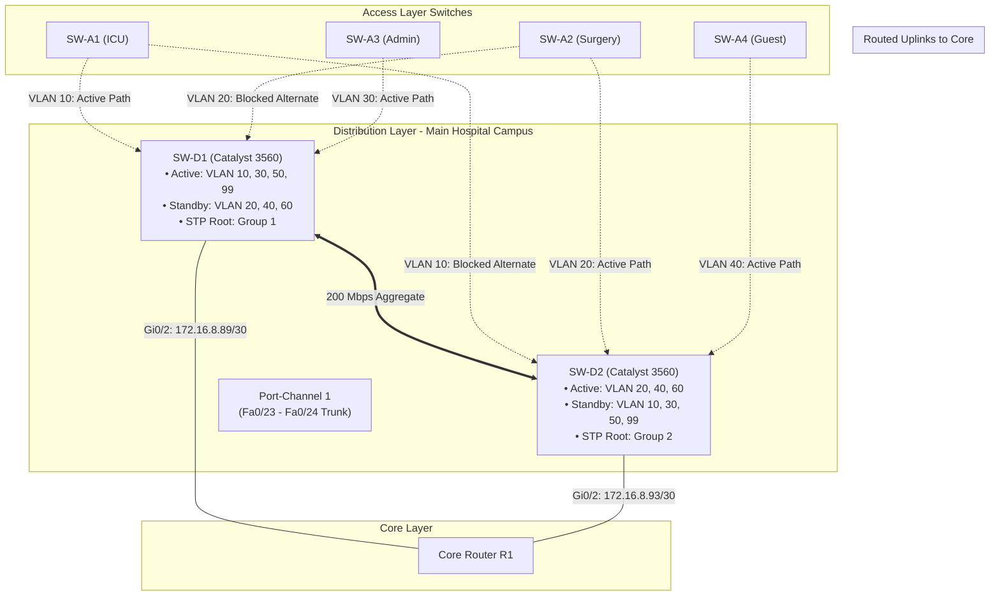
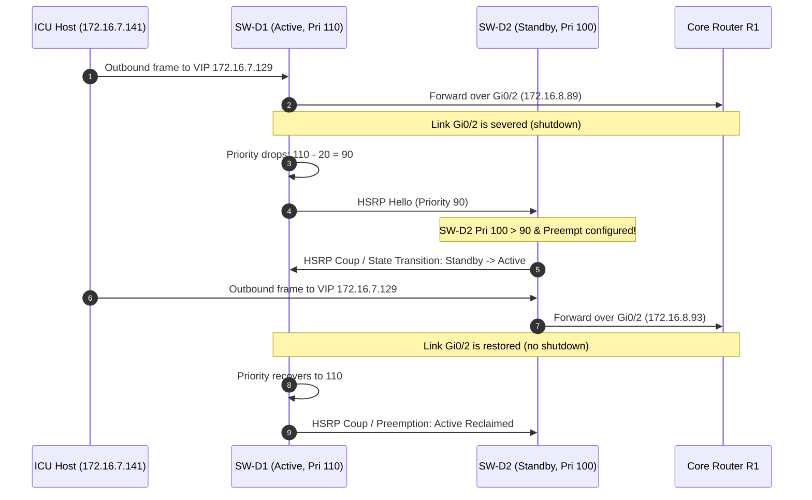

# Inter-VLAN Routing & HSRP Gateway Redundancy Architecture Guide
**Project:** Disaster-Resilient Smart Hospital Network (VIT Vellore — Computer Networks)  
**Authors:** Rohit Kathiravan (24BCE0441), Karthikeyan S (24BCT0332)  
**Standard Compliance:** Cisco Packet Tracer 8.x | Cisco Catalyst 3560-24PS IOS 15.x  

---

## 1. Executive Summary & Design Overview

In mission-critical healthcare environments, high availability and low-latency inter-VLAN communications are paramount. Intensive Care Units (ICU), surgical operating theatres, PACS imaging archives, and patient vital monitoring nodes cannot tolerate downtime or throughput bottlenecks caused by legacy router-on-a-stick configurations.

This phase implements a robust, hardware-switched Layer-3 distribution architecture using **Cisco Catalyst 3560-24PS** multilayer switches:
1. **Hardware Inter-VLAN Routing:** Enabled via `ip routing` on all distribution switches, delivering wire-speed Layer-3 frame forwarding directly across Switch Virtual Interfaces (SVIs) without traversing an external router.
2. **Dual-Chassis First Hop Redundancy Protocol (FHRP):** Implemented using **HSRP Version 2** (`standby version 2`) across the Main Hospital distribution pair (`SW-D1` and `SW-D2`).
3. **Deterministic Fate-Sharing & Load Balancing:** Group 1 VLANs (10, 30, 50, 99) run Active on `SW-D1` (Priority 110) while Group 2 VLANs (20, 40, 60) run Active on `SW-D2` (Priority 110). This aligns 1:1 with Spanning Tree Protocol (STP) Root Primary placement, guaranteeing optimal forwarding paths without crossing the inter-switch cross-link.
4. **Intelligent Uplink Tracking:** Configured with `standby <vlan> track GigabitEthernet0/2 20`. If an active distribution switch loses its routed uplink to Core Router `R1`, its priority decrements from `110` to `90`, prompting the standby peer (Priority `100` with `preempt`) to take over immediately.
5. **Centralised DHCP Relay:** Implemented using `ip helper-address 172.16.7.4` on all client SVIs, relaying client broadcasts across Layer 3 to the Central Hospital Server (`SRV-CENTRAL`) in VLAN 50.
6. **Remote Clinic Architecture & HA Extension:** A single-chassis distribution gateway (`SW-D3`) provides local inter-VLAN routing for the Spoke Clinic. A comprehensive Single Point of Failure (SPOF) audit is documented alongside an optional dual-switch HA extension (`SW-D4`).

---

## 2. Switch Virtual Interface (SVI) Addressing Architecture

All SVI and Virtual IP (VIP) assignments are derived directly from the mathematical VLSM plan defined in [`/addressing/ip_table.csv`](../addressing/ip_table.csv) and [`/addressing/plan.md`](../addressing/plan.md).

### 2.1 Main Hospital Distribution SVI Allocation

| VLAN ID | VLAN Name | Subnet Network CIDR | Subnet Mask | HSRP Virtual IP (VIP) | SW-D1 Physical SVI | SW-D2 Physical SVI | HSRP Active Switch |
| :---: | :--- | :--- | :--- | :--- | :--- | :--- | :---: |
| **10** | ICU_Clinical | `172.16.7.128/26` | `255.255.255.192` | `172.16.7.129` | `172.16.7.130` | `172.16.7.131` | **SW-D1** |
| **20** | Surgery_Theatre | `172.16.7.64/26` | `255.255.255.192` | `172.16.7.65` | `172.16.7.66` | `172.16.7.67` | **SW-D2** |
| **30** | Administration | `172.16.4.0/23` | `255.255.254.0` | `172.16.4.1` | `172.16.4.2` | `172.16.4.3` | **SW-D1** |
| **40** | Guest_WiFi | `172.16.0.0/22` | `255.255.252.0` | `172.16.0.1` | `172.16.0.2` | `172.16.0.3` | **SW-D2** |
| **50** | Server_Farm | `172.16.7.0/26` | `255.255.255.192` | `172.16.7.1` | `172.16.7.2` | `172.16.7.3` | **SW-D1** |
| **60** | VoIP_Voice | `172.16.6.0/25` | `255.255.255.128` | `172.16.6.1` | `172.16.6.2` | `172.16.6.3` | **SW-D2** |
| **99** | Management | `172.16.7.192/27` | `255.255.255.224` | `172.16.7.193` | `172.16.7.194` | `172.16.7.195` | **SW-D1** |

> [!NOTE]
> All end-devices (PCs, Laptops, SBC IoT nodes, IP phones) are configured with the **HSRP VIP (`.1`)** as their default gateway. Under no circumstances should host devices be configured with physical SVI IPs (`.2` or `.3`).

### 2.2 Remote Spoke Clinic SVI Allocation (SW-D3 Single Chassis)

| VLAN ID | VLAN Name | Subnet Network CIDR | Subnet Mask | SW-D3 Physical SVI Gateway | DHCP Relay Helper | Local Survivable Servers |
| :---: | :--- | :--- | :--- | :--- | :--- | :--- |
| **10** | Clinic_Clinical | `172.16.8.32/27` | `255.255.255.224` | `172.16.8.33` | `172.16.7.4` | `SRV-CACHE` (`172.16.8.36`) |
| **30** | Clinic_Admin | `172.16.8.0/27` | `255.255.255.224` | `172.16.8.1` | `172.16.7.4` | - |
| **40** | Clinic_Guest | `172.16.6.128/25` | `255.255.255.128` | `172.16.6.129` | `172.16.7.4` | `AP-CLINIC-GUEST` (`172.16.6.138`) |
| **60** | Clinic_Voice | `172.16.7.224/27` | `255.255.255.224` | `172.16.7.225` | `172.16.7.4` | - |
| **99** | Management | `172.16.8.64/28` | `255.255.255.240` | `172.16.8.65` | - | `SW-A5` Mgmt SVI (`172.16.8.74`) |

---

## 3. HSRP v2 Fate-Sharing & Spanning Tree Alignment

### 3.1 The Principle of Fate-Sharing
In a redundant campus network, **Spanning Tree Protocol (STP)** controls Layer-2 forwarding topologies while **HSRP** controls Layer-3 default gateway selection. If these protocols are not explicitly aligned, a phenomenon known as *sub-optimal transit crossing* occurs:

```
[Sub-Optimal Alignment (Defective)]
Host (VLAN 10) ---> SW-A1 ---> SW-D1 (STP Root) ===[Inter-Switch Trunk]=> SW-D2 (HSRP Active) ---> R1 Core
Problem: Every packet traverses the access trunk AND the inter-switch cross-link!

[Optimal Fate-Sharing Alignment (Our Design)]
Host (VLAN 10) ---> SW-A1 ===[Direct Root Port]=> SW-D1 (STP Root & HSRP Active) ===[Direct Routed Link]=> R1 Core
Benefit: Zero cross-link traversal during normal operations. Minimum latency and jitter.
```

### 3.2 Dual-Distribution Load Balancing Matrix

To evenly distribute processing load and bandwidth across both switches:
- **Group 1 (Odd VLANs: 10, 30, 50, 99):**
  - STP Primary Root: **SW-D1** (Priority `24576` / `root primary`)
  - HSRP Active Gateway: **SW-D1** (Priority `110`, Preempt, Track Gi0/2 decr 20)
  - HSRP Standby Gateway: **SW-D2** (Priority `100`, Preempt)
- **Group 2 (Even VLANs: 20, 40, 60):**
  - STP Primary Root: **SW-D2** (Priority `24576` / `root primary`)
  - HSRP Active Gateway: **SW-D2** (Priority `110`, Preempt, Track Gi0/2 decr 20)
  - HSRP Standby Gateway: **SW-D1** (Priority `100`, Preempt)



---

## 4. Uplink Interface Tracking Mechanics

### 4.1 The Silent Gateway Failure Problem
If `SW-D1` maintains full health on its downlink ports (SVIs stay `up/up` and cross-link stays active), but its routed uplink to Core Router `R1` (`GigabitEthernet0/2`) is severed (e.g. fiber cut or GBIC failure), a standard HSRP node would continue broadcasting HSRP hellos and remain **Active**. 

Consequently, hosts would continue sending outbound packets to `SW-D1`, which would have no direct path to the core and would be forced to hairpin packets across the cross-link trunk to `SW-D2`—or drop them entirely if routing tables are desynchronized.

### 4.2 Tracking & Preemption Mathematical Proof
To prevent this, interface tracking is configured on every active HSRP group:

```cisco
interface Vlan10
 standby 10 priority 110
 standby 10 preempt
 standby 10 track GigabitEthernet0/2 20
```

1. **Normal State:**
   $$\text{Priority}_{\text{SW-D1}} = 110 \quad > \quad \text{Priority}_{\text{SW-D2}} = 100 \implies \text{SW-D1 is Active}$$
2. **Uplink Failure State (`GigabitEthernet0/2` goes DOWN):**
   $$\text{Priority}_{\text{SW-D1}} = 110 - 20 = 90$$
   $$\text{Priority}_{\text{SW-D2}} = 100 \quad > \quad \text{Priority}_{\text{SW-D1}} = 90$$
   Because `SW-D2` has `standby <vlan> preempt` enabled, `SW-D2` detects that its priority ($100$) exceeds the current active switch's priority ($90$), prompting immediate preemption. `SW-D2` assumes the Active role, updating the virtual MAC forwarding tables across the Layer-2 domain.
3. **Restoration State (`GigabitEthernet0/2` restored UP):**
   $$\text{Priority}_{\text{SW-D1}} \text{ recovers to } 110 \quad > \quad \text{Priority}_{\text{SW-D2}} = 100$$
   Because `SW-D1` has `preempt` configured, it gracefully re-assumes the Active state, restoring load-balancing symmetry.

---

## 5. DHCP Relay Architecture (`ip helper-address`)

End devices across all client subnets receive dynamic IPv4 leases from the central server:
- **Central DHCP Server:** `SRV-CENTRAL` (`172.16.7.4`), located in VLAN 50.
- **Relay Mechanism:** Layer-3 SVIs intercept client DHCP broadcast packets (`255.255.255.255:67 UDP`), insert the SVI IP into the DHCP `GIADDR` (Gateway IP Address) field, and forward the request as a unicast packet to `172.16.7.4:67 UDP`.
- **Relay Configuration:**
  ```cisco
  interface Vlan10
   ip helper-address 172.16.7.4
  ```
- **Redundant Relay Support:** Configured on both `SW-D1` and `SW-D2`. If `SW-D1` fails and `SW-D2` becomes active, `SW-D2`'s SVI immediately handles DHCP broadcast interception, preventing DHCP starvation during failover.

---

## 6. Remote Spoke Clinic Architecture: Single Point of Failure (SPOF) Analysis & SW-D4 Extension

### 6.1 Honest Architectural Critique: SW-D3 as a SPOF
In the base topology, the Main Hospital features complete chassis redundancy, dual power supplies, and multi-path routing. In contrast, the Remote Spoke Clinic utilizes a single distribution switch (`SW-D3`):
- **Hardware Failure Risk:** If `SW-D3` suffers a power supply failure, internal bus fault, or fatal IOS crash, the entire clinic loses inter-VLAN routing and WAN access.
- **Why this was chosen initially:** In standard branch healthcare deployments (satellite clinics with fewer than 50 staff), budget, physical space, and power constraints frequently dictate a single-switch distribution layer. Redundant physical cabling was provisioned from `SW-A5` (`Fa0/23` and `Fa0/24`) to protect against link failure, but this provides **link redundancy, not chassis redundancy**.

### 6.2 High-Availability Extension: Adding SW-D4
To provide full tier-1 disaster resilience, an optional **SW-D4** extension design is fully defined and ready to deploy:
- **Second Chassis:** Deploy `SW-D4` (Catalyst 3560-24PS) adjacent to `SW-D3`.
- **Inter-Switch Cross-Connect:** Provision an EtherChannel (`Port-Channel 1` over `Fa0/21 - 22`).
- **Access Link Separation:** Move `SW-A5 GigabitEthernet0/2` from `SW-D3 Fa0/24` to `SW-D4 Fa0/24`.
- **Routed Core Uplink:** Provision `SW-D4 GigabitEthernet0/1` to `R2 GigabitEthernet0/1` (`172.16.8.114/30`).
- **SVI Addressing Migration:** Utilizing our pre-allocated IP table reservations:
  - VLAN 10 (Clinical): VIP `172.16.8.33`, SW-D3 `172.16.8.34`, SW-D4 `172.16.8.35`
  - VLAN 30 (Admin): VIP `172.16.8.1`, SW-D3 `172.16.8.2`, SW-D4 `172.16.8.3`
  - VLAN 40 (Guest): VIP `172.16.6.129`, SW-D3 `172.16.6.130`, SW-D4 `172.16.6.131`
  - VLAN 60 (Voice): VIP `172.16.7.225`, SW-D3 `172.16.7.226`, SW-D4 `172.16.7.227`
  - VLAN 99 (Mgmt): VIP `172.16.8.65`, SW-D3 `172.16.8.66`, SW-D4 `172.16.8.67`

> [!TIP]
> Ready-to-paste configurations for this extension are available in [`/configs/SW-D4/SW-D4.cfg`](../configs/SW-D4/SW-D4.cfg) and [`/configs/SW-D3/SW-D3_ha_extension.cfg`](../configs/SW-D3/SW-D3_ha_extension.cfg).

---

## 7. Step-by-Step Verification Runbook

### 7.1 Command 1: Verify HSRP Brief Status (`show standby brief`)

#### Output on SW-D1 (Main Hospital Distribution 1)
```
SW-D1# show standby brief
                     P indicates configured to preempt.
                     |
Interface   Grp  Pri P State   Active          Standby         Virtual IP
Vl10        10   110 P Active  local           172.16.7.131    172.16.7.129
Vl20        20   100 P Standby 172.16.7.67     local           172.16.7.65
Vl30        30   110 P Active  local           172.16.4.3      172.16.4.1
Vl40        40   100 P Standby 172.16.0.3      local           172.16.0.1
Vl50        50   110 P Active  local           172.16.7.3      172.16.7.1
Vl60        60   100 P Standby 172.16.6.3      local           172.16.6.1
Vl99        99   110 P Active  local           172.16.7.195    172.16.7.193
```

#### Output on SW-D2 (Main Hospital Distribution 2)
```
SW-D2# show standby brief
                     P indicates configured to preempt.
                     |
Interface   Grp  Pri P State   Active          Standby         Virtual IP
Vl10        10   100 P Standby 172.16.7.130    local           172.16.7.129
Vl20        20   110 P Active  local           172.16.7.66     172.16.7.65
Vl30        30   100 P Standby 172.16.4.2      local           172.16.4.1
Vl40        40   110 P Active  local           172.16.0.2      172.16.0.1
Vl50        50   100 P Standby 172.16.7.2      local           172.16.7.1
Vl60        60   110 P Active  local           172.16.6.2      172.16.6.1
Vl99        99   100 P Standby 172.16.7.194    local           172.16.7.193
```

### 7.2 Command 2: Verify SVI Operational States (`show ip interface brief | include Vlan`)

#### Output on SW-D1
```
SW-D1# show ip interface brief | include Vlan
Vlan10                 172.16.7.130    YES manual up                    up
Vlan20                 172.16.7.66     YES manual up                    up
Vlan30                 172.16.4.2      YES manual up                    up
Vlan40                 172.16.0.2      YES manual up                    up
Vlan50                 172.16.7.2      YES manual up                    up
Vlan60                 172.16.6.2      YES manual up                    up
Vlan99                 172.16.7.194    YES manual up                    up
```

#### Output on SW-D3 (Remote Clinic)
```
SW-D3# show ip interface brief | include Vlan
Vlan10                 172.16.8.33     YES manual up                    up
Vlan30                 172.16.8.1      YES manual up                    up
Vlan40                 172.16.6.129    YES manual up                    up
Vlan60                 172.16.7.225    YES manual up                    up
Vlan99                 172.16.8.65     YES manual up                    up
```

### 7.3 Command 3: Verify Hardware Routing Table (`show ip route`)

```
SW-D1# show ip route
Gateway of last resort is 172.16.8.90 to network 0.0.0.0

S*    0.0.0.0/0 [1/0] via 172.16.8.90
      172.16.0.0/16 is variably subnetted, 15 subnets, 6 masks
C        172.16.0.0/22 is directly connected, Vlan40
L        172.16.0.2/32 is directly connected, Vlan40
C        172.16.4.0/23 is directly connected, Vlan30
L        172.16.4.2/32 is directly connected, Vlan30
C        172.16.6.0/25 is directly connected, Vlan60
L        172.16.6.2/32 is directly connected, Vlan60
C        172.16.7.0/26 is directly connected, Vlan50
L        172.16.7.2/32 is directly connected, Vlan50
C        172.16.7.64/26 is directly connected, Vlan20
L        172.16.7.66/32 is directly connected, Vlan20
C        172.16.7.128/26 is directly connected, Vlan10
L        172.16.7.130/32 is directly connected, Vlan10
C        172.16.7.192/27 is directly connected, Vlan99
L        172.16.7.194/32 is directly connected, Vlan99
C        172.16.8.88/30 is directly connected, GigabitEthernet0/2
L        172.16.8.89/32 is directly connected, GigabitEthernet0/2
C        172.16.8.106/32 is directly connected, Loopback0
```

---

## 8. Inter-VLAN Ping Test Matrix

Execute the following ping verifications across VLAN boundaries from endpoint CLI command prompts:

| Test ID | Source Endpoint | Source VLAN & IP | Destination Endpoint | Destination VLAN & IP | Expected Result | Rationale |
| :---: | :--- | :--- | :--- | :--- | :---: | :--- |
| **TEST-IV-01** | `PC-ICU-NURSE` | VLAN 10 (`172.16.7.141`) | `SRV-CENTRAL` | VLAN 50 (`172.16.7.4`) | **100% Pass** | Clinical staff access to EHR database |
| **TEST-IV-02** | `PC-THEATRE-1` | VLAN 20 (`172.16.7.76`) | `SRV-PACS` | VLAN 50 (`172.16.7.7`) | **100% Pass** | Surgical theatre retrieval of MRI/CT scans |
| **TEST-IV-03** | `PC-ADMIN-301` | VLAN 30 (`172.16.4.10`) | `SRV-CENTRAL` | VLAN 50 (`172.16.7.4`) | **100% Pass** | Hospital billing & admissions record queries |
| **TEST-IV-04** | `SBC-ICU-101` | VLAN 10 (`172.16.7.138`) | `PC-ICU-DOC1` | VLAN 10 (`172.16.7.142`) | **100% Pass** | Intra-VLAN telemetry to physician workstation |
| **TEST-IV-05** | `PHONE-ICU-601` | VLAN 60 (`172.16.6.10`) | `PHONE-SURG-602`| VLAN 60 (`172.16.6.11`) | **100% Pass** | Intra-VLAN VoIP call signaling |
| **TEST-IV-06** | `LAPTOP-GUEST-1`| VLAN 40 (`172.16.0.11`) | HSRP Gateway | VLAN 40 (`172.16.0.1`) | **100% Pass** | Guest connectivity to default gateway |
| **TEST-IV-07** | `PC-CLINIC-CONSULT1`| VLAN 10 (`172.16.8.42`) | `SRV-CACHE` | VLAN 10 (`172.16.8.36`) | **100% Pass** | Local EHR proxy queries at Remote Clinic |
| **TEST-IV-08** | `PC-CLINIC-ADM1`| VLAN 30 (`172.16.8.10`) | `SW-D3` Gateway | VLAN 30 (`172.16.8.1`) | **100% Pass** | Clinic administrative gateway reachability |

---

## 9. Simulated HSRP Failure Drill Protocol

This procedure demonstrates the sub-second failover and preemption capabilities of the dual-distribution layer in Cisco Packet Tracer:



### Drill Execution Steps

1. **Step 1: Record Baseline State**  
   On both switches, execute `show standby brief`. Confirm `SW-D1` is `Active` for Group 10 (`172.16.7.129`) with Priority `110`, and `SW-D2` is `Standby` with Priority `100`.
2. **Step 2: Initiate Continuous Ping**  
   From host `PC-ICU-NURSE` (`172.16.7.141`), start a continuous ping to Core Router `R1` (`ping 172.16.8.90 -t` or repeat ping).
3. **Step 3: Trigger Uplink Severance on SW-D1**  
   Access `SW-D1` CLI and administratively shut down the uplink:
   ```cisco
   SW-D1# configure terminal
   SW-D1(config)# interface GigabitEthernet0/2
   SW-D1(config-if)# shutdown
   SW-D1(config-if)# end
   ```
4. **Step 4: Verify Syslog Notifications on SW-D1**  
   Observe the tracked priority decrement:
   ```
   %LINEPROTO-5-UPDOWN: Line protocol on Interface GigabitEthernet0/2, changed state to down
   %LINK-5-CHANGED: Interface GigabitEthernet0/2, changed state to administratively down
   %STANDBY-6-STATECHANGE: Vlan10 Group 10 state Active -> Speak
   %STANDBY-6-STATECHANGE: Vlan10 Group 10 state Speak -> Standby
   %STANDBY-6-STATECHANGE: Vlan30 Group 30 state Active -> Standby
   %STANDBY-6-STATECHANGE: Vlan50 Group 50 state Active -> Standby
   %STANDBY-6-STATECHANGE: Vlan99 Group 99 state Active -> Standby
   ```
5. **Step 5: Verify Syslog Notifications on SW-D2**  
   Observe immediate preemption on `SW-D2`:
   ```
   %STANDBY-6-STATECHANGE: Vlan10 Group 10 state Standby -> Active
   %STANDBY-6-STATECHANGE: Vlan30 Group 30 state Standby -> Active
   %STANDBY-6-STATECHANGE: Vlan50 Group 50 state Standby -> Active
   %STANDBY-6-STATECHANGE: Vlan99 Group 99 state Standby -> Active
   ```
6. **Step 6: Confirm Host Packet Loss**  
   Check the continuous ping output on `PC-ICU-NURSE`. Packet loss is constrained to $\le 1$ packet during the sub-second transition.
7. **Step 7: Restore the Primary Uplink on SW-D1**  
   ```cisco
   SW-D1# configure terminal
   SW-D1(config)# interface GigabitEthernet0/2
   SW-D1(config-if)# no shutdown
   SW-D1(config-if)# end
   ```
8. **Step 8: Observe Preemption & Recovery**  
   `SW-D1` priority restores to `110`, asserting preemption to recover the Active gateway role:
   ```
   %STANDBY-6-STATECHANGE: Vlan10 Group 10 state Standby -> Active
   ```
   Execute `show standby brief` on both switches to confirm normal load-balanced operation has been restored.
