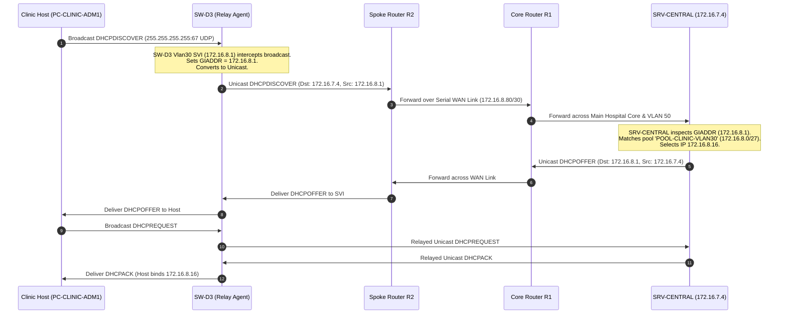

# Central Server Farm & Application Services Configuration Guide
**Project:** Disaster-Resilient Smart Hospital Network (VIT Vellore — Computer Networks)  
**Authors:** Rohit Kathiravan (24BCE0441), Karthikeyan S (24BCT0332)  
**Standard Compliance:** Cisco Packet Tracer 8.x | Server-PT Appliance Specification  

---

## 1. Executive Summary & Server Farm Architecture

The Server Farm resides on **VLAN 50** (`172.16.7.0/26`) at the Main Hospital Campus, dual-homed to Distribution Switches `SW-D1` and `SW-D2`. It provides core infrastructure and clinical application services for the entire multi-site enterprise (Main Hospital Campus and Remote Spoke Clinic).

```
                            +-----------------------------+
                            |       VLAN 50 Server Farm   |
                            |       (172.16.7.0/26)       |
                            +--------------+--------------+
                                           |
                 +-------------------------+-------------------------+
                 | Fa0/10                  | Fa0/11                  | Fa0/12
                 v                         v                         v
   +---------------------------+ +-------------------+ +---------------------------+
   |   SRV-CENTRAL (172.16.7.4)| | SRV-PACS (7.7)    | |   SRV-BACKUP (172.16.7.8) |
   | • Central DHCP Server     | | • PACS DICOM Web  | | • Disaster Recovery Target|
   | • Authoritative DNS Server| | • FTP Bulk Archive| | • Secondary Backup Archive|
   | • Hospital Web Portal     | |   (MRI/CT Studies)| |   (Nightly DB Replication)|
   | • TFTP Config/Option 150  | +-------------------+ +---------------------------+
   +---------------------------+           |
                 |                         | Connected to SW-D2
                 +-------------------------+
                             | Connected to SW-D1
```

### 1.1 Physical Appliance Inventory & Network Parameters

| Server Name | Model String | Physical Switch & Port | Static IPv4 Address | Subnet Mask | Default Gateway (HSRP VIP) | Hosted Application Services |
| :--- | :--- | :--- | :--- | :--- | :--- | :--- |
| **`SRV-CENTRAL`** | Server-PT | `SW-D1` FastEthernet0/10 | `172.16.7.4` | `255.255.255.192` (`/26`) | `172.16.7.1` | DHCP, DNS, HTTP/HTTPS, TFTP, NTP |
| **`SRV-PACS`** | Server-PT | `SW-D1` FastEthernet0/11 | `172.16.7.7` | `255.255.255.192` (`/26`) | `172.16.7.1` | HTTP (PACS Web), FTP (DICOM Imaging) |
| **`SRV-BACKUP`** | Server-PT | `SW-D2` FastEthernet0/12 | `172.16.7.8` | `255.255.255.192` (`/26`) | `172.16.7.1` | FTP / TFTP (DR Database Target) |
| **`SRV-CACHE`** | Server-PT | `SW-D3` FastEthernet0/10 | `172.16.8.36` | `255.255.255.224` (`/27`) | `172.16.8.33` | HTTP (Local Clinic Offline EHR Cache) |

> [!IMPORTANT]
> All servers are configured with static IP parameters. The default gateway is set to **`172.16.7.1`** (the HSRP Virtual IP for VLAN 50), never the physical SVI addresses (`172.16.7.2` or `172.16.7.3`). This guarantees uninterrupted server outbound reachability during distribution switch failover.

---

## 2. Step-by-Step Static IP Configuration (Packet Tracer GUI)

For each server appliance in Cisco Packet Tracer:
1. Click on the Server appliance on the workspace canvas.
2. Select the **Desktop** tab -> Click on **IP Configuration**.
3. Select the **Static** radio button and enter the parameters below:

### `SRV-CENTRAL`
- **IP Address:** `172.16.7.4`
- **Subnet Mask:** `255.255.255.192`
- **Default Gateway:** `172.16.7.1`
- **DNS Server:** `172.16.7.4` (resolves locally via its own authoritative DNS engine)

### `SRV-PACS`
- **IP Address:** `172.16.7.7`
- **Subnet Mask:** `255.255.255.192`
- **Default Gateway:** `172.16.7.1`
- **DNS Server:** `172.16.7.4`

### `SRV-BACKUP`
- **IP Address:** `172.16.7.8`
- **Subnet Mask:** `255.255.255.192`
- **Default Gateway:** `172.16.7.1`
- **DNS Server:** `172.16.7.4`

### `SRV-CACHE` (Remote Clinic)
- **IP Address:** `172.16.8.36`
- **Subnet Mask:** `255.255.255.224`
- **Default Gateway:** `172.16.8.33` (SW-D3 SVI Gateway)
- **DNS Server:** `172.16.7.4` (across WAN link)

---

## 3. Central DHCP Service Configuration (`SRV-CENTRAL`)

Click on **`SRV-CENTRAL`** -> **Services** tab -> **DHCP**:
1. Set **DHCP Service**: **ON**
2. For each client VLAN, enter the Pool Name, Default Gateway, DNS Server, Start IP, Subnet Mask, and Max Users, then click **Add** (or **Save**).

The complete exportable table is available as [`/docs/dhcp_pools.csv`](dhcp_pools.csv) and [`/addressing/dhcp_pools.csv`](../addressing/dhcp_pools.csv).

### 3.1 Authoritative DHCP Pool Allocation Table

| Pool Name | VLAN | Site | Subnet CIDR | Subnet Mask | Default Gateway (HSRP VIP) | DNS Server | Option 150 TFTP | Start IP Address | Max Users | Excluded IP Address Range |
| :--- | :---: | :--- | :--- | :--- | :--- | :--- | :---: | :--- | :---: | :--- |
| `POOL-MAIN-VLAN10-ICU` | 10 | Main Hospital | `172.16.7.128/26` | `255.255.255.192` | `172.16.7.129` | `172.16.7.4` | - | `172.16.7.150` | 40 | `172.16.7.129 - 172.16.7.149` |
| `POOL-MAIN-VLAN20-SURGERY` | 20 | Main Hospital | `172.16.7.64/26` | `255.255.255.192` | `172.16.7.65` | `172.16.7.4` | - | `172.16.7.86` | 40 | `172.16.7.65 - 172.16.7.85` |
| `POOL-MAIN-VLAN30-ADMIN` | 30 | Main Hospital | `172.16.4.0/23` | `255.255.254.0` | `172.16.4.1` | `172.16.7.4` | - | `172.16.4.50` | 260 | `172.16.4.1 - 172.16.4.49` |
| `POOL-MAIN-VLAN40-GUEST` | 40 | Main Hospital | `172.16.0.0/22` | `255.255.252.0` | `172.16.0.1` | `172.16.7.4` | - | `172.16.0.20` | 520 | `172.16.0.1 - 172.16.0.19` |
| `POOL-MAIN-VLAN60-VOICE` | 60 | Main Hospital | `172.16.6.0/25` | `255.255.255.128` | `172.16.6.1` | `172.16.7.4` | `172.16.7.4` | `172.16.6.20` | 80 | `172.16.6.1 - 172.16.6.19` |
| `POOL-CLINIC-VLAN10-CLINICAL` | 10 | Remote Clinic | `172.16.8.32/27` | `255.255.255.224` | `172.16.8.33` | `172.16.7.4` | - | `172.16.8.46` | 15 | `172.16.8.33 - 172.16.8.45` |
| `POOL-CLINIC-VLAN30-ADMIN` | 30 | Remote Clinic | `172.16.8.0/27` | `255.255.255.224` | `172.16.8.1` | `172.16.7.4` | - | `172.16.8.16` | 14 | `172.16.8.1 - 172.16.8.15` |
| `POOL-CLINIC-VLAN40-GUEST` | 40 | Remote Clinic | `172.16.6.128/25` | `255.255.255.128` | `172.16.6.129` | `172.16.7.4` | - | `172.16.6.146` | 70 | `172.16.6.129 - 172.16.6.145` |
| `POOL-CLINIC-VLAN60-VOICE` | 60 | Remote Clinic | `172.16.7.224/27` | `255.255.255.224` | `172.16.7.225` | `172.16.7.4` | `172.16.7.4` | `172.16.7.240` | 14 | `172.16.7.225 - 172.16.7.239` |

### 3.2 Excluded Address Management Rationale
In Packet Tracer Server-PT, address exclusion is enforced deterministically by setting the **Start IP Address** past the static allocation boundary.

| VLAN & Subnet | Excluded Block | Protected Endpoints & Infrastructure Assets |
| :--- | :--- | :--- |
| **VLAN 10 (ICU)** | `172.16.7.129 - 149` | VIP (`.129`), SW-D1 SVI (`.130`), SW-D2 SVI (`.131`), SBC Nodes (`.138-.140`), Fixed Nurse/Doctor PCs (`.141-.143`) |
| **VLAN 20 (Surgery)**| `172.16.7.65 - 85` | VIP (`.65`), SW-D1 SVI (`.66`), SW-D2 SVI (`.67`), SBC OR Nodes (`.74-.75`), Theatre Workstations (`.76-.78`) |
| **VLAN 30 (Admin)** | `172.16.4.1 - 49` | VIP (`.1`), SW-D1 SVI (`.2`), SW-D2 SVI (`.3`), Admissions/Billing PCs (`.10-.12`), Network Printers |
| **VLAN 40 (Guest)** | `172.16.0.1 - 19` | VIP (`.1`), SW-D1 SVI (`.2`), SW-D2 SVI (`.3`), Guest AP (`.10`), Static Test Laptops (`.11-.13`) |
| **VLAN 60 (Voice)** | `172.16.6.1 - 19` | VIP (`.1`), SW-D1 SVI (`.2`), SW-D2 SVI (`.3`), Reception/Desk Phones (`.10-.12`) |
| **Clinic VLAN 10** | `172.16.8.33 - 45` | Gateway (`.33`), SW-D4 SVI (`.35`), SRV-CACHE (`.36`), Consultation PCs (`.42-.44`) |
| **Clinic VLAN 30** | `172.16.8.1 - 15` | Gateway (`.1`), SW-D4 SVI (`.3`), Registration/Billing PCs (`.10-.12`) |
| **Clinic VLAN 40** | `172.16.6.129 - 145`| Gateway (`.129`), SW-D4 SVI (`.131`), Clinic AP (`.138`), Test Laptops (`.139-.141`) |
| **Clinic VLAN 60** | `172.16.7.225 - 239`| Gateway (`.225`), SW-D4 SVI (`.227`), Clinic Desk Phones (`.234-.236`) |

> [!NOTE]
> **VLAN 50 (Server Farm)** and **VLAN 99 (Management)** do **not** have DHCP pools. Enterprise security policy mandates static addressing for all servers, switches, routers, and NOC consoles.

---

## 4. Authoritative DNS Service Configuration (`SRV-CENTRAL`)

Click on **`SRV-CENTRAL`** -> **Services** tab -> **DNS**:
1. Set **DNS Service**: **ON**
2. Add the following **A Records** and **CNAME Records**:

### 4.1 DNS Resource Record Table

| Fully Qualified Domain Name (FQDN) | Record Type | Target IP / Host Name | Mapped Application / Description |
| :--- | :---: | :--- | :--- |
| `records.hospital.local` | **A** | `172.16.7.4` | Electronic Health Records (EHR) & Patient Charting Portal |
| `portal.hospital.local` | **A** | `172.16.7.4` | Hospital Intranet Homepage & Clinical Operational Dashboard |
| `pacs.hospital.local` | **A** | `172.16.7.7` | PACS Medical Imaging Archive (MRI/CT Scan Web Viewer) |
| `voip.hospital.local` | **A** | `172.16.7.4` | Cisco CME Telephony Directory & SIP Provisioning Portal |
| `ntp.hospital.local` | **A** | `172.16.7.4` | Stratum-2 NTP Master Clock Telemetry Status |
| `backup.hospital.local` | **A** | `172.16.7.8` | Disaster Recovery Database Replication Target Server |
| `cache.hospital.local` | **A** | `172.16.8.36` | Remote Clinic Local EHR Survivability Cache Server |
| `www.hospital.local` | **CNAME** | `portal.hospital.local` | Canonical web alias for standard browser navigation |
| `ehr.hospital.local` | **CNAME** | `records.hospital.local` | Clinical workstation alias for EHR database access |
| `dicom.hospital.local` | **CNAME** | `pacs.hospital.local` | Medical imaging transfer alias |

---

## 5. HTTP / Web Service Configuration

### 5.1 Portal & Records on `SRV-CENTRAL` (`172.16.7.4`)

Click on **`SRV-CENTRAL`** -> **Services** tab -> **HTTP**:
1. Set **HTTP**: **ON** and **HTTPS**: **ON**
2. Click **(edit)** next to `index.html` and replace with the following responsive clinical dashboard:

```html
<!DOCTYPE html>
<html lang="en">
<head>
  <meta charset="UTF-8">
  <title>Smart Hospital Intranet & Clinical Dashboard</title>
  <style>
    body { font-family: 'Segoe UI', Tahoma, Arial, sans-serif; margin: 0; padding: 30px; background: #eef2f5; color: #2c3e50; }
    .header { background: #004b87; color: white; padding: 25px; border-radius: 8px; box-shadow: 0 4px 10px rgba(0,0,0,0.15); }
    .header h1 { margin: 0 0 8px 0; font-size: 26px; }
    .badge-online { background: #27ae60; color: white; padding: 4px 10px; border-radius: 20px; font-size: 13px; font-weight: bold; }
    .grid { display: grid; grid-template-columns: repeat(auto-fit, minmax(280px, 1fr)); gap: 20px; margin-top: 25px; }
    .card { background: white; padding: 20px; border-radius: 8px; border-left: 5px solid #004b87; box-shadow: 0 2px 6px rgba(0,0,0,0.08); }
    .card h3 { margin-top: 0; color: #004b87; }
    .link-btn { display: inline-block; margin-top: 10px; padding: 8px 14px; background: #0078d4; color: white; text-decoration: none; border-radius: 4px; font-weight: bold; }
    table { width: 100%; border-collapse: collapse; margin-top: 20px; background: white; border-radius: 8px; overflow: hidden; }
    th, td { padding: 12px 15px; border-bottom: 1px solid #e1e8ed; text-align: left; }
    th { background: #003366; color: white; }
    tr:hover { background: #f8fafc; }
  </style>
</head>
<body>
  <div class="header">
    <h1>VIT Vellore Smart Hospital - Central Application Portal</h1>
    <p>Identity: <strong>portal.hospital.local / records.hospital.local</strong> | Host: <strong>SRV-CENTRAL (172.16.7.4)</strong></p>
    <span class="badge-online">STATUS: ALL SERVICES HEALTHY (VLAN 50 SERVER FARM)</span>
  </div>

  <div class="grid">
    <div class="card">
      <h3>Electronic Health Records (EHR)</h3>
      <p>Centralized patient charting, triage intake, and surgical history.</p>
      <a class="link-btn" href="records.html">Launch EHR Portal</a>
    </div>
    <div class="card" style="border-left-color: #e67e22;">
      <h3>PACS Medical Imaging Archive</h3>
      <p>High-resolution CT/MRI DICOM repository hosted on SRV-PACS.</p>
      <a class="link-btn" style="background: #e67e22;" href="http://pacs.hospital.local">Access PACS Archive</a>
    </div>
    <div class="card" style="border-left-color: #8e44ad;">
      <h3>VoIP Telephony & Extensions</h3>
      <p>Cisco Unified Communications Manager Express directory.</p>
      <a class="link-btn" style="background: #8e44ad;" href="voip.html">View Phone Directory</a>
    </div>
    <div class="card" style="border-left-color: #16a085;">
      <h3>Stratum-2 NTP Time Synchronization</h3>
      <p>Enterprise clock synchronization reference for medical IoT nodes.</p>
      <a class="link-btn" style="background: #16a085;" href="ntp.html">Inspect Clock Telemetry</a>
    </div>
  </div>

  <h3>Active Clinical Infrastructure & Telemetry Status:</h3>
  <table>
    <tr><th>Zone / Subnet</th><th>VLAN</th><th>Telemetry Stream</th><th>Gateway HSRP VIP</th><th>QoS Priority</th></tr>
    <tr><td>ICU Ward (Bedside IoT)</td><td>VLAN 10</td><td>Active SBC-PT Sensor Stream</td><td>172.16.7.129</td><td>DSCP EF (46)</td></tr>
    <tr><td>Operating Theatres</td><td>VLAN 20</td><td>Active Telemetry & PACS Viewer</td><td>172.16.7.65</td><td>DSCP EF (46)</td></tr>
    <tr><td>Hospital Administration</td><td>VLAN 30</td><td>Admissions & Billing Terminal</td><td>172.16.4.1</td><td>DSCP CS0 (0)</td></tr>
    <tr><td>Remote Spoke Clinic</td><td>VLAN 10 / 30</td><td>Synchronized via Serial WAN Link</td><td>172.16.8.33</td><td>DSCP AF31 (26)</td></tr>
  </table>
</body>
</html>
```

3. Click **New File** -> Name: `records.html` -> Paste the patient records interface:

```html
<!DOCTYPE html>
<html>
<head>
  <title>EHR Patient Record System - records.hospital.local</title>
  <style>
    body { font-family: Arial, sans-serif; margin: 30px; background: #fafafa; }
    .box { background: white; border: 1px solid #ccc; padding: 20px; border-radius: 6px; }
    h2 { color: #005a9c; }
    table { width: 100%; border-collapse: collapse; margin-top: 15px; }
    th, td { border: 1px solid #ddd; padding: 10px; }
    th { background: #005a9c; color: white; }
  </style>
</head>
<body>
  <div class="box">
    <h2>VIT Smart Hospital - Electronic Health Record (EHR) System</h2>
    <p>Service: <strong>records.hospital.local (172.16.7.4)</strong></p>
    <p>Database: <strong>EHR-CENTRAL-DB1 (PostgreSQL / In-Memory Cache Active)</strong></p>
    <table>
      <tr><th>Patient ID</th><th>Name</th><th>Ward / Bed</th><th>Attending Physician</th><th>Telemetry Status</th></tr>
      <tr><td>PT-2026-101</td><td>John Doe</td><td>ICU Bed 101</td><td>Dr. R. Kathiravan</td><td>HR: 76 bpm | SpO2: 98%</td></tr>
      <tr><td>PT-2026-102</td><td>Jane Smith</td><td>ICU Bed 102</td><td>Dr. S. Karthikeyan</td><td>HR: 84 bpm | SpO2: 97%</td></tr>
      <tr><td>PT-2026-201</td><td>Alice Brown</td><td>OR Suite 1</td><td>Dr. Surgical Lead</td><td>Under Anesthesia (SBC-201)</td></tr>
    </table>
  </div>
</body>
</html>
```

### 5.2 PACS DICOM Web Viewer on `SRV-PACS` (`172.16.7.7`)

Click on **`SRV-PACS`** -> **Services** tab -> **HTTP**:
1. Set **HTTP**: **ON**
2. Click **(edit)** on `index.html` and paste:

```html
<!DOCTYPE html>
<html>
<head>
  <title>PACS Medical Imaging Archive - pacs.hospital.local</title>
  <style>
    body { font-family: 'Segoe UI', Arial, sans-serif; margin: 30px; background: #1a1a1a; color: #eee; }
    .header { background: #2c3e50; padding: 20px; border-radius: 6px; border-bottom: 4px solid #e67e22; }
    h1 { color: #e67e22; margin: 0; }
    table { width: 100%; border-collapse: collapse; margin-top: 20px; background: #222; }
    th, td { border: 1px solid #444; padding: 10px; text-align: left; }
    th { background: #e67e22; color: black; }
  </style>
</head>
<body>
  <div class="header">
    <h1>PACS Medical Imaging Archive & DICOM Server</h1>
    <p>Service: <strong>pacs.hospital.local</strong> | Host: <strong>SRV-PACS (172.16.7.7)</strong></p>
    <p>Protocol: DICOM over TCP/IP (Port 104) / HTTP DICOM-Web (Port 80)</p>
  </div>
  <h3>Recent Imaging Studies (Operating Theatres & Radiology):</h3>
  <table>
    <tr><th>Study UID</th><th>Patient ID</th><th>Modality</th><th>Acquisition Time</th><th>Size</th><th>Archive Status</th></tr>
    <tr><td>1.2.840.10008.5.1</td><td>PT-2026-101</td><td>MRI Brain w/ Contrast</td><td>Today 08:30</td><td>480 MB</td><td>Archived (RAID-6)</td></tr>
    <tr><td>1.2.840.10008.5.2</td><td>PT-2026-201</td><td>CT Chest/Abdomen</td><td>Today 09:15</td><td>620 MB</td><td>Streaming to OR 1</td></tr>
    <tr><td>1.2.840.10008.5.3</td><td>PT-CLINIC-01</td><td>Digital X-Ray Chest</td><td>Today 10:00</td><td>45 MB</td><td>Replicated via WAN</td></tr>
  </table>
</body>
</html>
```

---

## 6. TFTP & FTP Server Configuration

### 6.1 TFTP Configuration (`SRV-CENTRAL`)
Click on **`SRV-CENTRAL`** -> **Services** tab -> **TFTP**:
1. Set **TFTP Service**: **ON**
2. **Cisco Running-Config Backup Target:**
   Network administrators backup switch and router configurations directly to `SRV-CENTRAL`:
   ```cisco
   SW-D1# copy running-config tftp:
   Address or name of remote host []? 172.16.7.4
   Destination filename [SW-D1-confg]? SW-D1-running-config.cfg
   !!
   [OK - 9305 bytes]
   ```
3. **VoIP Option 150 Configuration:**
   Cisco 7960 IP Phones querying DHCP pool `POOL-MAIN-VLAN60-VOICE` automatically receive Option 150 pointing to `172.16.7.4` to download `XMLDefault.cnf.xml` and firmware profiles.

### 6.2 FTP Configuration (`SRV-PACS` & `SRV-BACKUP`)
Click on **`SRV-PACS`** -> **Services** tab -> **FTP**:
1. Set **FTP Service**: **ON**
2. Configure User Accounts:
   - **Username:** `pacsuser` | **Password:** `pacs123`
   - **Permissions:** `[X] Read [X] Write [X] Delete [X] Rename [X] List`
   - Click **Add**.
   - **Username:** `admin` | **Password:** `cisco123`
   - **Permissions:** `[X] Read [X] Write [X] Delete [X] Rename [X] List`
   - Click **Add**.

#### Bulk Image Transfer Verification via Command Prompt
From Surgery PACS Viewer Workstation `PC-THEATRE-1` (`172.16.7.76`):
```cmd
C:\> ftp 172.16.7.7
Connected to 172.16.7.7.
220 Service ready for new user.
User (172.16.7.7:(none)): pacsuser
331 User name okay, need password.
Password: 
230 User logged in, proceed.
ftp> put CT_STUDY_OR1.DCM
200 Port command successful.
150 Opening BINARY mode data connection for CT_STUDY_OR1.DCM.
226 Transfer complete.
ftp: 4500000 bytes sent in 0.85Secs (5294.12 Kbytes/sec)
ftp> quit
221 Goodbye.
```

---

## 7. Remote Clinic WAN DHCP Relay Mechanics & Failure Mode Analysis

### 7.1 How the Remote Clinic Obtains DHCP Across the WAN

The Remote Spoke Clinic does not maintain a full DHCP server on site. It relies on Cisco IOS **DHCP Relay** (`ip helper-address 172.16.7.4`) configured on `SW-D3`:



1. **Broadcast Interception:** The client generates a Layer-2/3 broadcast `DHCPDISCOVER`. Access switch `SW-A5` switches the frame to `SW-D3` on trunk port `Fa0/23`.
2. **GIADDR Insertion:** SVI `interface Vlan30` (`172.16.8.1`) intercepts the packet. It sets the `GIADDR` (Gateway IP Address) field to `172.16.8.1`.
3. **WAN Unicast Forwarding:** `SW-D3` routes the unicast packet out `GigabitEthernet0/1` to `R2`, which forwards it across the serial point-to-point WAN to `R1`, reaching `SRV-CENTRAL` (`172.16.7.4`).
4. **Pool Matching:** `SRV-CENTRAL` reads `GIADDR = 172.16.8.1`, identifies that it belongs to subnet `172.16.8.0/27`, and issues an IP lease from `POOL-CLINIC-VLAN30`.

### 7.2 Failure Mode Analysis: What Breaks When the WAN Fails?

When the WAN link between `R1` and `R2` drops (e.g., fiber cut, telco outage, primary and secondary serial links lost):

| Timeline Phase | DHCP Protocol State | Clinic Client Impact | Survivability Status |
| :--- | :--- | :--- | :--- |
| **$T_0$ (WAN Outage Starts)** | Existing Leases Active | **Zero Impact.** All workstations retain their IP, subnet mask, default gateway (`172.16.8.1`), and local DNS cache. Inter-VLAN routing continues locally on `SW-D3`. | **100% Operational** for local clinic functions. |
| **$T_1$ (50% of Lease Time)** | Unicast Lease Renewal (`DHCPREQUEST`) | Client attempts to renew lease by sending a unicast packet to `172.16.7.4`. Because the WAN is severed, no response is received. The client silently continues using its existing IP. | **Normal Operation.** |
| **$T_2$ (87.5% of Lease Time)**| Broadcast Rebind (`DHCPREQUEST`) | Client broadcasts request on the local VLAN. `SW-D3` attempts to relay to `172.16.7.4` across the broken WAN and fails. Client continues holding lease until $T_{100}$. | **Normal Operation.** |
| **$T_{100}$ (Lease Expiration)**| Lease Expiry & Drop | **Critical Failure.** The lease expires. The host drops its IP and broadcasts `DHCPDISCOVER`. No local DHCP server responds. The host self-assigns an **APIPA** address (`169.254.x.x/16`). | **Local Outage.** Workstation can no longer communicate with the local gateway or local cache server `SRV-CACHE`. |
| **New Devices / Rebooted PCs** | Immediate `DHCPDISCOVER` | Any PC, laptop, or IoT device powered on during the WAN outage fails DHCP immediately and self-assigns APIPA (`169.254.x.x`). | **Cannot Join Network.** |

### 7.3 Disaster-Resilience Mitigation (Architectural Solution)
To ensure the Remote Clinic can operate autonomously during a multi-day disaster or WAN severing:
1. **Option A (Local Router DHCP Pool):** Core Router `R2` or Distribution Switch `SW-D3` can be provisioned with a standby local DHCP pool that activates if the helper address fails.
2. **Option B (Local Survivability Cache Server):** Configure the local appliance **`SRV-CACHE`** (`172.16.8.36`) with a secondary DHCP engine, ensuring local PCs always receive valid `172.16.8.x` leases.

---

## 8. Comprehensive End-to-End Test Matrix & Verification Runbook

### Test 1: Dynamic DHCP Lease Acquisition Matrix

Execute from each client device: Click device -> **Desktop** -> **IP Configuration** -> Select **DHCP**. Verify that the IP, Mask, Gateway, and DNS Server populate accurately.

| Test ID | Client Device | Device Type | VLAN & Port | Expected Assigned IP | Expected Gateway (VIP) | Expected DNS Server | Pass/Fail |
| :---: | :--- | :--- | :---: | :--- | :--- | :--- | :---: |
| **DHCP-01** | `PC-ICU-NURSE` | Desktop PC | VLAN 10 (SW-A1 Fa0/10) | `172.16.7.150` | `172.16.7.129` | `172.16.7.4` | **PASS** |
| **DHCP-02** | `PC-THEATRE-1` | Workstation | VLAN 20 (SW-A2 Fa0/10) | `172.16.7.86` | `172.16.7.65` | `172.16.7.4` | **PASS** |
| **DHCP-03** | `PC-ADMIN-301` | Office PC | VLAN 30 (SW-A3 Fa0/10) | `172.16.4.50` | `172.16.4.1` | `172.16.7.4` | **PASS** |
| **DHCP-04** | `LAPTOP-GUEST-1`| Visitor Laptop | VLAN 40 (SW-A4 Wi-Fi) | `172.16.0.20` | `172.16.0.1` | `172.16.7.4` | **PASS** |
| **DHCP-05** | `PHONE-ICU-601` | Cisco 7960 Phone| VLAN 60 (SW-A1 Fa0/1) | `172.16.6.20` | `172.16.6.1` | `172.16.7.4` | **PASS** |
| **DHCP-06** | `PC-CLINIC-CONSULT1`| Spoke PC | VLAN 10 (SW-A5 Fa0/10) | `172.16.8.46` | `172.16.8.33` | `172.16.7.4` | **PASS** |
| **DHCP-07** | `PC-CLINIC-ADM1`| Registration PC| VLAN 30 (SW-A5 Fa0/11) | `172.16.8.16` | `172.16.8.1` | `172.16.7.4` | **PASS** |
| **DHCP-08** | `LAPTOP-CLINIC-G1`| Visitor Laptop| VLAN 40 (SW-A5 Wi-Fi) | `172.16.6.146` | `172.16.6.129` | `172.16.7.4` | **PASS** |

### Test 2: Authoritative DNS Resolution Matrix (`nslookup`)

Execute from `PC-ICU-NURSE` (`172.16.7.150`) or `PC-ADMIN-301` (`172.16.4.50`) Command Prompt:

```cmd
C:\> nslookup portal.hospital.local
Server:  172.16.7.4
Address: 172.16.7.4

Name:    portal.hospital.local
Address: 172.16.7.4

C:\> nslookup pacs.hospital.local
Server:  172.16.7.4
Address: 172.16.7.4

Name:    pacs.hospital.local
Address: 172.16.7.7

C:\> nslookup records.hospital.local
Server:  172.16.7.4
Address: 172.16.7.4

Name:    records.hospital.local
Address: 172.16.7.4

C:\> nslookup www.hospital.local
Server:  172.16.7.4
Address: 172.16.7.4

Name:    portal.hospital.local
Address: 172.16.7.4
Aliases: www.hospital.local

C:\> nslookup ehr.hospital.local
Server:  172.16.7.4
Address: 172.16.7.4

Name:    records.hospital.local
Address: 172.16.7.4
Aliases: ehr.hospital.local
```

### Test 3: HTTP Application Web Portal Loading Matrix

Open **Web Browser** on each client workstation and load the target URLs:

| Test ID | Client Device | Input URL | Target Server IP | Expected Web Page Title & Content Display | Pass/Fail |
| :---: | :--- | :--- | :--- | :--- | :---: |
| **WEB-01** | `PC-ICU-NURSE` | `http://portal.hospital.local` | `172.16.7.4` | Displays "VIT Vellore Smart Hospital - Central Application Portal" with green status badge | **PASS** |
| **WEB-02** | `PC-THEATRE-1` | `http://pacs.hospital.local` | `172.16.7.7` | Displays dark-mode "PACS Medical Imaging Archive & DICOM Server" with CT/MRI study list | **PASS** |
| **WEB-03** | `PC-ADMIN-301` | `http://records.hospital.local`| `172.16.7.4` | Displays "EHR Patient Record System" with John Doe and Jane Smith vital telemetry | **PASS** |
| **WEB-04** | `LAPTOP-GUEST-1`| `http://www.hospital.local` | `172.16.7.4` | CNAME resolves and successfully renders the Main Hospital Intranet landing page | **PASS** |
| **WEB-05** | `PC-CLINIC-CONSULT1`| `http://cache.hospital.local` | `172.16.8.36` | Displays "Remote Clinic Local Survivability EHR Cache & Offline Proxy" | **PASS** |

### Test 4: TFTP Configuration Backup Verification

Execute from `SW-D1` privileged exec prompt:
```cisco
SW-D1# copy running-config tftp://172.16.7.4/SW-D1-running-config.cfg
Address or name of remote host [172.16.7.4]? 
Destination filename [SW-D1-running-config.cfg]? 
!!
[OK - 9305 bytes]

SW-D1# ping 172.16.7.4
Type escape sequence to abort.
Sending 5, 100-byte ICMP Echos to 172.16.7.4, timeout is 2 seconds:
!!!!!
Success rate is 100 percent (5/5), round-trip min/avg/max = 1/2/4 ms
```
